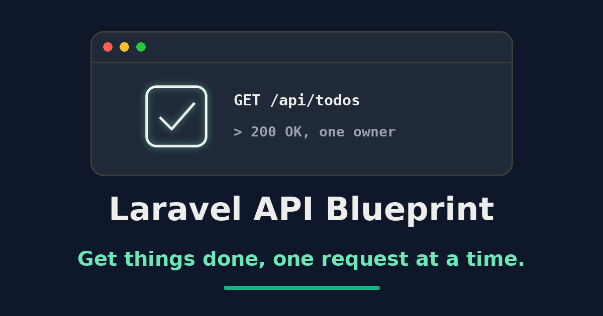

# Laravel API Blueprint

[](phpunit.xml)
[](LICENSE.md)
[](composer.json)
[](https://www.php.net/)
[](https://laravel.com/)

> Get things done, one request at a time.

A token-authenticated Laravel REST API for managing personal todo items. Laravel API Blueprint is a compact reference implementation of a layered Laravel service: resource controllers, a service and repository layer, API resources, Sanctum tokens, and per-user data scoping.



## Table of Contents

- [Features](#features)
- [Tech Stack](#tech-stack)
- [Install](#install)
  - [Requirements](#requirements)
  - [Local Setup](#local-setup)
- [Usage](#usage)
- [API](#api)
  - [Endpoints](#endpoints)
  - [Todo Fields](#todo-fields)
  - [Examples](#examples)
- [Postman Collection](#postman-collection)
- [API Documentation](#api-documentation)
- [Database Schema Viewer](#database-schema-viewer)
- [Testing](#testing)
  - [Git Hooks](#git-hooks)
- [Open Graph Image](#open-graph-image)
- [Contributing](#contributing)
- [License](#license)

---

## Features

- **Token authentication:** Exchange credentials for a Laravel Sanctum personal access token and call protected endpoints with a bearer header.
- **Todo resource:** Create, list, read, update, and delete todos through a conventional `apiResource` route set.
- **Per-user scoping:** Protected todo routes combine `auth:sanctum` with a `UserScope` global scope to constrain queries to the authenticated user. The scope is inactive without authentication; console commands and jobs must establish ownership explicitly.
- **Layered design:** Controllers delegate to services, services delegate to repositories, and only repositories touch Eloquent.
- **Typed domain errors:** Dedicated exceptions carry translated messages and HTTP status codes into the JSON error response.
- **Consistent envelopes:** API resources emit a stable `type` / `id` / `attributes` shape; the base controller wraps success in `data` and failure in `error`. Invalid input returns a 422 with Laravel's `message` and `errors` fields. Unexpected controller failures return a generic translated 500 response without internal exception details. Error logs record only exception type and source file/line, excluding exception messages, request data, and traces.
- **Soft deletes:** Deleted todos are retained in the database rather than destroyed.
- **Rate limiting:** Global throttling on the API group with a stricter limit on token issuance.
- **Localized messages:** Response strings resolve through translation files for English and Serbian.
- **Generated documentation:** Scramble derives an OpenAPI document straight from the application code.

[⬆ back to top](#table-of-contents)

---

## Tech Stack

- **Backend:** PHP 8.5 and Laravel 13
- **Authentication:** Laravel Sanctum personal access tokens
- **Database:** SQLite by default; any Laravel-supported driver via `.env`
- **Testing:** PHPUnit with a required minimum coverage of 100%
- **Quality:** Rector, Peck, Laravel Pint, PHPStan/Larastan (level 6), and Sloppy
- **Documentation:** Scramble (OpenAPI) and Laravel Boost

[⬆ back to top](#table-of-contents)

---

## Install

### Requirements

- PHP 8.5.x only, with the extensions required by [`composer.json`](composer.json), for both the CLI and web server
- Composer 2
- Node.js 20 or newer with npm, for the Husky Git hooks and Postman generation
- Python 3 with [Pillow](https://pypi.org/project/pillow/), only to regenerate the [Open Graph image](#open-graph-image)

### Local Setup

Clone the repository and create the local environment file:

```bash
git clone https://github.com/zlatanstajic/laravel-api-blueprint.git
cd laravel-api-blueprint
cp .env.example .env
```

Configure the database and the default admin account in `.env`, then run:

```bash
composer setup
```

The setup script installs PHP and Node.js dependencies, creates the SQLite database file, generates the application key, recreates and seeds the database, refreshes the IDE helper files, and runs the complete quality suite. Because it runs `migrate:fresh`, it deletes existing data in the configured development database.

The seeders create an admin account for local development from these `.env` values. Supply your own admin email:

| Variable | Configuration | Description |
|---|---|---|
| `ADMIN_NAME` | `Admin` | Display name of the seeded admin |
| `ADMIN_EMAIL` | `<your-admin-email>` | Login email for token requests |
| `ADMIN_PASSWORD` | `secret` | Login password for token requests |

Change these values before using the application in any non-local environment.

[⬆ back to top](#table-of-contents)

---

## Usage

Start the local application, queue listener, and log viewer with:

```bash
composer run serve
```

The application is available at `http://localhost:8000` by default. To start only the HTTP server:

```bash
php artisan serve
```

[⬆ back to top](#table-of-contents)

---

## API

All routes are throttled to 60 requests per minute. Token issuance is throttled to 3 requests per minute. The two throttles use separate counters: token attempts also count once toward the global limit, while other API requests do not consume the token allowance. Todo routes require the `auth:sanctum` middleware and operate exclusively on the authenticated user's records.

### Endpoints

| Method | Path | Auth | Description |
|---|---|---|---|
| `GET` | `/api/` | Public | Welcome message |
| `POST` | `/api/tokens` | Public | Exchange `email` and `password` for a bearer token |
| `GET` | `/api/todos` | Bearer | List the authenticated user's todos |
| `POST` | `/api/todos` | Bearer | Create a todo |
| `GET` | `/api/todos/{id}` | Bearer | Read a single todo |
| `PUT`/`PATCH` | `/api/todos/{id}` | Bearer | Update a todo |
| `DELETE` | `/api/todos/{id}` | Bearer | Soft delete a todo |

Unknown email addresses and incorrect passwords both return `401` with `{"error":"Invalid credentials"}` in English. Since API version 1.1.0, an unknown email no longer returns a distinct 404 response. Unknown-email attempts also perform password hashing with the configured algorithm and cost to avoid the fast rejection path. This reduces timing differences; it does not guarantee identical response times, especially when existing password hashes use older costs.

### Todo Fields

| Field | Type | Notes |
|---|---|---|
| `user_id` | integer | Owner; set from the authenticated user, never from the request body |
| `title` | string | Required on create, `max:255` |
| `description` | string \| null | Optional free text |
| `completed` | boolean | Defaults to `false` |
| `created_at` | datetime | Immutable datetime cast |
| `updated_at` | datetime | Immutable datetime cast |
| `deleted_at` | datetime \| null | Set by the soft delete |

### Examples

Exchange credentials for a token. The credentials come from your environment (`ADMIN_EMAIL` and `ADMIN_PASSWORD`):

```bash
curl -X POST http://localhost:8000/api/tokens \
    -H "Content-Type: application/json" \
    -d '{"email":"<your-admin-email>","password":"secret"}'
```

Tokens expire after 24 hours. Sanctum rejects expired or revoked tokens, invalid secrets, and tokens belonging to deleted users.

Use the returned bearer token to call protected endpoints:

```bash
curl http://localhost:8000/api/todos \
    -H "Authorization: Bearer <token>"
```

Create a todo:

```bash
curl -X POST http://localhost:8000/api/todos \
    -H "Authorization: Bearer <token>" \
    -H "Content-Type: application/json" \
    -d '{"title":"Write the README","completed":false}'
```

[⬆ back to top](#table-of-contents)

---

## Postman Collection

A ready-to-use Postman collection and environment live in the [`postman`](postman) directory.

- **Collection:** [`laravel-api-blueprint.postman_collection.json`](postman/laravel-api-blueprint.postman_collection.json) contains requests for authentication, the welcome message, and every Todo operation.
- **Environment:** [`laravel-api-blueprint-development.postman_environment.json`](postman/laravel-api-blueprint-development.postman_environment.json) is pre-configured with the base API URL. Fill in `ADMIN_EMAIL` and `ADMIN_PASSWORD` with the values from your `.env`; the token request stores the returned token in `ACCESS_TOKEN`.

The collection is generated from Scramble's OpenAPI document with a dependency-free Node.js exporter. After changing routes or validation, regenerate it with:

```bash
composer docs:postman
```

This builds the documentation against your migrated development database and rewrites the collection. It preserves the `BASE_URL`, `ADMIN_EMAIL`, `ADMIN_PASSWORD`, and `ACCESS_TOKEN` variable names. Set `TODO_ID` to a todo belonging to your account before using an item request. The token request clears a previous token when login fails; credentials are supplied only through your private Postman environment.

The exporter supports the JSON request schemas used by this API, including local schema references. It fails explicitly on unsupported schemas or remote references rather than generating misleading requests.

To verify an existing documentation build without rewriting the collection:

```bash
npm run test:postman
npm run postman:check
```

CI runs both checks after generating the OpenAPI document and fails if the committed collection is stale. Change the generator at [`scripts/gen-postman-collection.mjs`](scripts/gen-postman-collection.mjs), never the generated collection by hand. Response documentation remains in the OpenAPI site; the collection contains requests without generated response examples.

[⬆ back to top](#table-of-contents)

---

## API Documentation

The published documentation lives at **<https://zlatanstajic.github.io/laravel-api-blueprint/>**.

The `dedoc/scramble` development dependency generates an OpenAPI document from the application code, so the docs never drift from the routes. Title, description, version, and server list are configured in [`config/scramble.php`](config/scramble.php).

### While developing

Scramble serves the document on two routes:

- `/docs/api` — interactive documentation viewer
- `/docs/api.json` — the OpenAPI JSON document, usable with any tool that accepts OpenAPI/Swagger

Scramble exposes these routes in the `local` environment only. To reach them elsewhere, configure the `viewApiDocs` gate as described in the [Scramble documentation](https://scramble.dedoc.co/usage/getting-started#docs-authorization).

### Static build

```bash
php artisan docs:build
```

This writes a self-contained site into the git-ignored `build/docs` directory:

- `index.html` — the same Stoplight Elements viewer Scramble serves, with the specification inlined, so it works from any host and any sub-path
- `api.json` — the OpenAPI document
- `favicon.svg` — the documentation favicon

Pass `--path=` to build somewhere else.

Scramble reads the configured database schema to infer model attributes. Apply the project's migrations to your development database before building the documentation. CI creates and migrates a temporary SQLite database for this step.

### Deployment

[`.github/workflows/docs.yml`](.github/workflows/docs.yml) runs the complete Composer quality gate and builds the documentation for pull requests into `master` and pushes to `master` or `issues/**`. Only successful runs on `master` upload the Pages artifact and deploy it to GitHub Pages. Deployments share a concurrency group to prevent overlapping publication. It needs **Settings → Pages → Source: GitHub Actions** enabled once on the repository; the workflow can also be started by hand from the Actions tab on `master`.

[⬆ back to top](#table-of-contents)

---

## Database Schema Viewer

[Laravel Truss](https://github.com/albertoarena/laravel-truss) is installed as a development dependency. With `APP_ENV=local` and the database migrated, open `/truss` on your local application to inspect tables, columns, and foreign keys. It reads schema structure, not application rows.

The viewer and its schema endpoint return 404 outside the local environment. [`config/truss.php`](config/truss.php) also disables schema baseline files and the optional MCP server. No application provider depends on Truss, so production installs with `composer install --no-dev` can boot without it. Truss does not change migrations or application data.

[⬆ back to top](#table-of-contents)

---

## Testing

Run the complete quality suite:

```bash
composer run test
```

This checks Rector, Peck, Pint, PHPStan, Sloppy, and PHPUnit in that order. Sloppy blocks on high or critical findings; medium findings remain advisory. PHPUnit enforces 100% coverage, so a new code path without a test fails the suite. Auto-fix what can be fixed with:

```bash
composer run fix
```

The test command uses array cache, and feature tests generate a temporary application key. Ownership and token integration tests configure an in-memory SQLite database and run migrations automatically; they never use your configured application database. The suite requires the PDO SQLite extension but no local database or application key.

GitHub Actions runs the same `composer test` gate for pull requests into `master` and pushes to `master` or `issues/**`. CI uses PHP 8.5 with coverage and spelling tools, installs locked dependencies with Composer scripts disabled, and supplies a temporary application key and array cache. Ownership tests create their own in-memory SQLite schema. Rector excludes Laravel's generated `bootstrap/cache` files; application source remains checked.

During development, run the smallest relevant test first:

```bash
php artisan test --compact tests/Unit/TodoServiceTest.php

# Or filter by test method name
php artisan test --compact --filter=test_name
```

Individual gate steps are available as `composer test:rector`, `composer test:peck`, `composer test:pint`, `composer test:phpstan`, `composer test:sloppy`, and `composer test:phpunit`.

### Git Hooks

The Husky hook at [`.husky/pre-commit`](.husky/pre-commit) runs `composer run test`, including Sloppy, before each commit. [`.husky/pre-push`](.husky/pre-push) runs `composer run test:sloppy` before each push. The hooks are installed by npm's `prepare` script when dependencies are installed. To install or refresh them explicitly, run:

```bash
npm run prepare
```

A failing check aborts the commit or push. Run `composer run test` or `composer run test:sloppy` directly to reproduce the failure. Bypass the hook for a single commit only when necessary with:

```bash
git commit --no-verify
```

[⬆ back to top](#table-of-contents)

---

## Open Graph Image

The social preview at [`assets/img/og-image.png`](assets/img/og-image.png) is generated, not hand-drawn. Regenerate it after changing the project name or tagline:

```bash
python3 scripts/gen-og-image.py
```

The script requires Pillow and a bold DejaVu or Liberation TrueType font. It contains no randomness and no timestamps, so the same inputs produce a byte-identical PNG on every run; if no suitable font is installed it fails loudly rather than falling back to a low-resolution default.

[⬆ back to top](#table-of-contents)

---

## Contributing

Contributions are welcome. Open an issue to discuss a change, then submit a pull request that keeps `composer run test` green, including the 100% coverage requirement.

Please follow the [Code of Conduct](CODE_OF_CONDUCT.md) when participating in project spaces.

Report suspected vulnerabilities privately using the instructions in [SECURITY.md](SECURITY.md).

[⬆ back to top](#table-of-contents)

---

## License

This project is licensed under the MIT License. See the [LICENSE](LICENSE.md) file for details.

[⬆ back to top](#table-of-contents)
